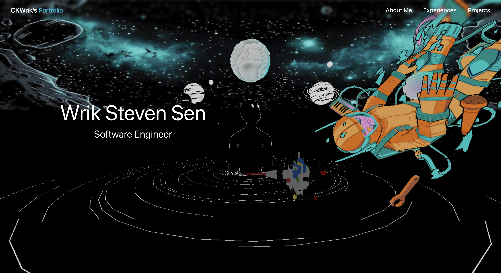
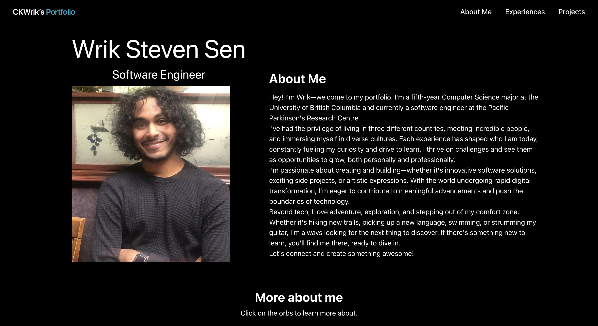

# Wrik Steven Sen — Portfolio

**Live site: [ckwrik.vercel.app](https://ckwrik.vercel.app)**

My personal portfolio: a React + TypeScript single-page app with an interactive Three.js scene, custom GLSL shaders, and scroll-driven camera animation.





## Features

- **Interactive 3D hero:** a Three.js scene with animated glTF models, a textured background, and bloom post-processing. The camera flies in on load and travels through the scene as you scroll.
- **Hand-written GLSL shaders:** the planets use custom diamond and noise shaders, and the navigation orbs use a toon (cel) shader whose light follows your scroll position.
- **Responsive layout:** stacked on mobile and tablet; a CSS grid laid over the canvas on desktop.
- **Client-side routing** with React Router (Home, Experiences, Projects), and animated page transitions with Framer Motion.
- **Accessibility:** CSS animations respect `prefers-reduced-motion`.

## Tech stack

| Area | Tools |
|---|---|
| Framework | React 19, TypeScript, Vite |
| 3D / graphics | Three.js, GLSL (vertex and fragment shaders), UnrealBloomPass |
| Styling | Tailwind CSS, plain CSS |
| Routing & animation | React Router 7, Framer Motion |
| Tooling | ESLint, PostCSS |
| Hosting | Vercel |

## How the 3D scene works

The scene lives in [`src/utils/introCanvas.tsx`](src/utils/introCanvas.tsx) and is set up once when the home page mounts:

1. **Setup** ([`setup.ts`](src/utils/setup.ts)) creates the scene, camera and WebGL renderer, and keeps them sized to the window.
2. **Content:** the glTF models load asynchronously with `GLTFLoader`. The astronaut's idle animation is driven by an `AnimationMixer`. The planets are spheres using `ShaderMaterial`s compiled from the `.glsl` files in [`src/utils/glsl/`](src/utils/glsl). Vite imports those files as strings with `?raw`.
3. **Post-processing:** an `EffectComposer` renders the scene, then applies an `UnrealBloomPass` for the glow.
4. **Camera:** a 2-second intro flies the camera in. After that, the camera's position is a function of `window.scrollY`. The intro always aims at the scroll-based position, so arriving already scrolled (for example via the "About Me" link) lands on the right view.
5. **Render loop:** one `requestAnimationFrame` loop updates the shader time uniforms and the animation mixer, then renders through the composer.
6. **Cleanup:** on unmount, the loop and listeners stop, every geometry, material and texture is disposed, and the WebGL context is released with `forceContextLoss()`. Each scene creates its own `<canvas>`, so a released context is never reused. That matters because React's StrictMode remounts components in development.

The orb buttons ([`OrbButton.tsx`](src/utils/OrbButton.tsx)) are tiny separate scenes. They only re-render when you scroll, at most once per frame, rather than running a 60 fps loop.

## Performance

- **Compressed 3D models.** The `.glb` files use [meshopt](https://meshoptimizer.org/) geometry compression and WebP textures, which took them from 7.4 MB to 1.0 MB with no visible change. `GLTFLoader` decodes them with three.js's `MeshoptDecoder`.
- **Code splitting.** Three.js, the scene and the orbs load on demand, only on the home page, so visitors who land on Projects or Experiences never download them. React, Framer Motion and Three.js each get their own file (see [`vite.config.ts`](vite.config.ts)), so they stay cached between deploys.
- **Lightweight images and clips.** The profile photo and scene background are WebP. The project clips are small MP4s that only download and play while on screen.

Performance was measured using chrome dev-tools: light house before and after optimizations
on a simulated slow 4G connection. the home page went from downloading 8.2 MB to 1.5 MB, FCP imrpoved from 2.3s to 1.9s, and LCP improved from 15.5s to 2.8s.

### Adding or replacing a 3D model

Compress new models the same way before adding them to `src/assets/glb/`:

```bash
npx @gltf-transform/cli optimize input.glb output.glb \
  --compress meshopt --texture-compress webp --texture-size 1024 --simplify false
```

`--simplify false` keeps the original geometry exactly. Leave it out to also reduce polygon counts, then check that the model still looks right.

## Project structure

```
src/
├── data/projects.ts     # all project content (Projects page + home page cards)
├── pages/               # HomePage, ExperiencesPage, ProjectsPage
├── utils/
│   ├── introCanvas.tsx  # main Three.js scene
│   ├── setup.ts         # renderer / camera / resize setup
│   ├── OrbButton.tsx    # toon-shaded 3D nav buttons
│   ├── glsl/            # Diamond, Normal_Noise and Toon shaders
│   ├── header.tsx, footer.tsx, contentSection.tsx, pageTransition.tsx
│   └── scrollToAboutMe.ts
├── assets/
│   ├── glb/             # 3D models, meshopt-compressed (see Credits)
│   └── images/          # scene background
├── App.tsx              # routes
├── App.css, index.css   # global and component styles
└── tailwind.css         # Tailwind directives (compiled at build time)
public/                  # profile photo, favicon, link-preview image, robots.txt, sitemap.xml
└── media/               # project clips (MP4) and posters (WebP)
vercel.json              # SPA rewrite so deep links like /Projects work
```

## Running locally

Requires Node.js 18+.

```bash
git clone https://github.com/coolkidwrik/portfolio.git
cd portfolio
npm install
npm run dev        # dev server at http://localhost:5173
```

| Script | What it does |
|---|---|
| `npm run dev` | Start the Vite dev server with hot reload |
| `npm run build` | Type-check with `tsc`, then build to `dist/` |
| `npm run preview` | Serve the production build locally |
| `npm run lint` | Run ESLint |

## Deployment

The site is deployed on Vercel, which builds `main` automatically. [`vercel.json`](vercel.json) rewrites every path with no matching file to `index.html`, so React Router can handle routes like `/Projects` on a direct visit or refresh.

## Credits

The 3D models are from Sketchfab:

- **Space Boi** by [silvercrow101](https://sketchfab.com/3d-models/space-boi-f6a8c6a6727b4f2cb020c8b50bb2ee60)
- **Tenhun Falling Spaceman (fanart)** by [wallmasterr](https://sketchfab.com/3d-models/tenhun-falling-spaceman-fanart-9fd80b6a259f41fd99e6f56eee686dc5)
- **Benny Space Man** by [Espeon](https://sketchfab.com/3d-models/benny-space-man-e1d53a3e44a04a649bb51fbe927c0ce9)

## Contact

- GitHub: [@coolkidwrik](https://github.com/coolkidwrik)
- LinkedIn: [wrik-sen](https://www.linkedin.com/in/wrik-sen/)
- Email: wriksen2003@gmail.com